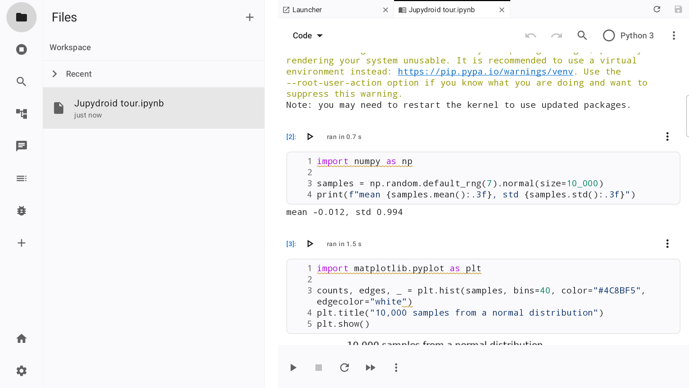
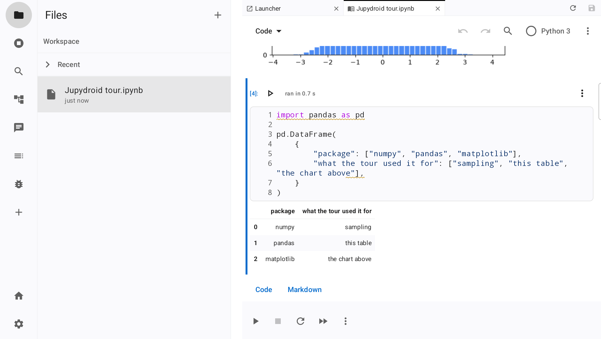

# Jupydroid

Offline Jupyter notebook app for Android. Runs a **real** `jupyter_server` inside a bundled
musl (Alpine) Linux rootfs, run unprivileged under `proot`, on loopback, with a mobile-optimised
UI: a Jetpack Compose shell and a **Compose-native** cell editor. A Space's kernel is `ipykernel`
on a second, glibc CPython beside the musl one, so PyPI's manylinux wheels install as released
([ADR-0166](docs/adr/0166-a-spaces-kernel-runs-on-a-second-glibc-interpreter-beside-musl.md)).
No remote server.

<picture>
  <source media="(prefers-color-scheme: dark)" srcset="docs-site/pages/images/notebook-with-outputs-dark.png">
  <source media="(prefers-color-scheme: light)" srcset="docs-site/pages/images/notebook-with-outputs-light.png">
  
</picture>

<picture>
  <source media="(prefers-color-scheme: dark)" srcset="docs-site/pages/images/html-table-output-dark.png">
  <source media="(prefers-color-scheme: light)" srcset="docs-site/pages/images/html-table-output-light.png">
  
</picture>

## Status

Working end to end on an arm64 tablet: the rootfs installs, `jupyter_server` starts on 127.0.0.1,
kernels start through `POST /api/sessions` and reattach, cells run and render their outputs
(stream, tracebacks, `text/html`, `text/markdown`, images, `text/plain`), and notebooks persist
as nbformat on a filesystem the app, the server and the kernel all share. There is a file browser,
a Compose cell editor with syntax highlighting and kernel-backed completion, and a two-pane
layout at ≥ 840dp.

Also built: **Spaces** — each an isolated system with its own rootfs, packages and Python
environments, run and stopped from a home screen, its settings covering idle shutdown, a thread
cap, environment variables, a startup script, a default kernel and environments, and its
harnesses installing chat agents; a Files panel that imports a `.ipynb` another app hands over
(**Open with Jupydroid**, 15 MiB cap — there is no import button); a real busybox terminal over
terminado; `pylsp` over stdio; the debugger over DAP on the kernel's control channel; the
console; workspace search and replace; the table of contents; **Settings** — the System/Light/Dark
theme, a launcher-icon choice, the editor rows, autosave, heading numbers, Diagnostics and
Licences; and, each its own
[extension module](docs/adr/0104-extensions-are-compile-time-modules-against-an-extension-api.md):
a read-only Source Control panel — git itself runs in the terminal — and an AI chat panel that
gives its agents MCP servers through `.jupyter/mcp_settings.json`.

What is *not* built is in [`docs/backlog.md`](docs/backlog.md), and the known gaps are
[`docs/architecture.md` §11](docs/architecture.md). Counts are **produced, not stored**, because a
stored one drifted repeatedly:

```sh
scripts/count-tests.sh                      # tests, flows and drivers, counted off the tree
grep -c "^### GAP-" docs/architecture.md    # documented gaps
grep -c "| shipped |" docs/backlog.md       # shipped items
```

Kotlin + Jetpack Compose, `com.jupydroid.app`, AGP 9, compileSdk 37, minSdk 32, targetSdk 36.
The runtime is **arm64-only**: Android's seccomp filter kills musl's startup on x86_64
([ADR-0003](docs/adr/0003-musl-not-glibc-and-arm64-only-at-runtime.md)), so there the app installs
and runs its UI against a fake kernel that echoes a cell's source back as its output.

## Install

Install a published release on an arm64 device — each
[Release](https://github.com/dmenezesgabriel/jupydroid/releases/latest) carries
`jupydroid-<version>-arm64-v8a.apk`, signed, with `SHA256SUMS`, an SBOM and `SOURCE_OFFER.md`:

```sh
adb install jupydroid-<version>-arm64-v8a.apk
```

The site's [Getting started](https://dmenezesgabriel.github.io/jupydroid/getting-started/) walks
the browser download and the checksum check. The first launch unpacks the rootfs, which takes a
while.

## Build from source

| Needs | For |
|---|---|
| JDK 17 | Gradle and the Kotlin toolchain |
| Android SDK | `sdk.dir` in `local.properties` |
| Docker | building the rootfs, proot and gnu payload images |
| `zstd` | compressing the payloads |
| Python 3 | `scripts/stage_proot_patched.py`, standard library only |
| network | the pinned upstream tarballs and packages, fetched by hash |

Building the arm64 images on an x86_64 host run under qemu, which needs Docker's arm64 binfmt
handler; `tools/rootfs/build.sh` says how to register it and that it does not survive a reboot.

```sh
tools/rootfs/build.sh arm64-v8a                  # the musl rootfs tarball, in build/rootfs/
tools/proot/build.sh                              # the patched proot, in build/proot/
tools/rootfs/build-gnu.sh                         # the glibc kernel payload, in build/rootfs/
tools/rootfs/stage-app-artifacts.sh arm64-v8a     # all of it, into the app module
./gradlew :app:assembleDebug
```

The rootfs and gnu payload assets and the `proot` pair (`libproot.so`, `libproot-loader.so`) are
build artifacts, not committed files, and an arm64 APK needs all of them. An x86_64 build needs
none: `stage-app-artifacts.sh x86_64` stages nothing, and the APK runs the fake kernel.

## Contributing and security

[`CONTRIBUTING.md`](CONTRIBUTING.md) is the working agreement: test first, small commits, the commit
gate, and a device check for anything that runs a cell. Take part under the
[Code of Conduct](CODE_OF_CONDUCT.md). Report a vulnerability privately, as
[`SECURITY.md`](SECURITY.md) describes.

## Licence

Apache-2.0: [`LICENSE`](LICENSE) and [`NOTICE`](NOTICE). The APK also carries third-party software,
listed in [`THIRD_PARTY.md`](THIRD_PARTY.md); [`SOURCE_OFFER.md`](SOURCE_OFFER.md) says where the
source of its GPL and LGPL parts is.

## Documentation

Start at **[`docs/README.md`](docs/README.md)**: it is the map, and it carries the id scheme and the
greps. Documents are separated by **lifetime**, not by topic
([ADR-0001](docs/adr/0001-split-durable-decisions-from-ephemeral-build-evidence.md)).

| Path | What it is | Lifetime |
|---|---|---|
| [`docs/architecture.md`](docs/architecture.md) + `docs/architecture/` | an arc42 description: goals, constraints, building blocks, runtime views, crosscutting concepts, risks | durable |
| [`docs/adr/`](docs/adr/) | one decision per file, and what each forbids | durable |
| [`docs/backlog.md`](docs/backlog.md) | what gets built next — one line per item | ephemeral |
| `docs/prd/` | how to build one item; written when it is picked up, deleted when it ships | ephemeral |
| [`docs/research/`](docs/research/) | measured investigations, and questions closed so nobody re-opens them | durable |
| [`docs-site/`](docs-site/) | the user documentation site — MkDocs Material, one page per feature area, live at the [Pages URL](https://dmenezesgabriel.github.io/jupydroid/) | durable |
| [`prompt-execution.md`](prompt-execution.md) | the procedure a clean session follows, in order | durable |
| [`AGENTS.md`](AGENTS.md) | how work is done: the working agreement, per-step procedure, tooling. Every agent, Claude Code included, reads it | durable |
| `evidence/<step>/` | the screenshots, snapshots and logs a step closed on, local and never committed ([ADR-0132](docs/adr/0132-evidence-is-local-and-reproduction-is-a-tested-script.md)) | ephemeral |

## Reference

Study material lives in `reference/`, which is **git-ignored**: none of it travels with a clone, and
nothing under it is ever vendored. A comment cites an upstream project as `<project>@<sha> <path>`
instead. [`docs/README.md`](docs/README.md) has the pinned SHAs and the clone commands, and
[`docs/architecture/cross-cutting.md` §8.3](docs/architecture/cross-cutting.md) records what each
reference is authoritative for, and §8.4 what each licence allows: Winlator and sora-editor are
LGPL-2.1 and therefore clean-room only.
